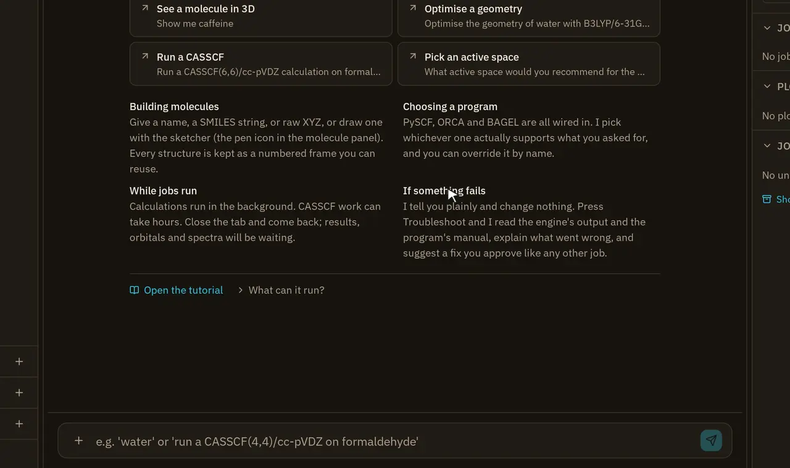
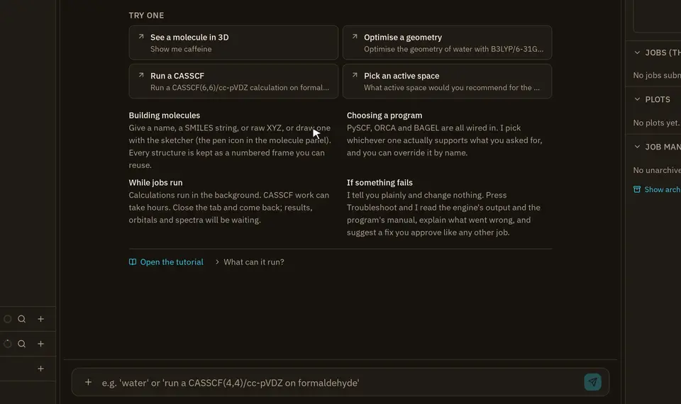
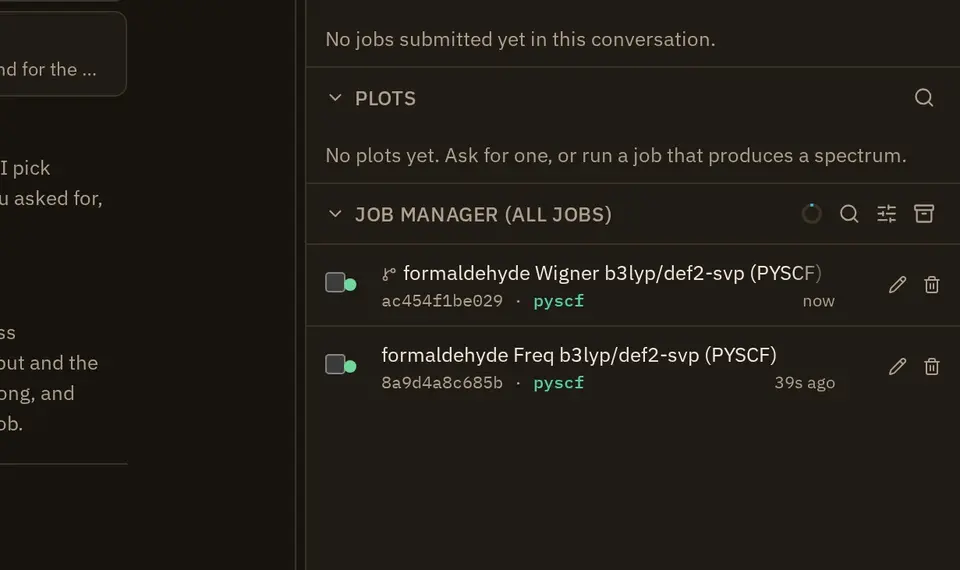
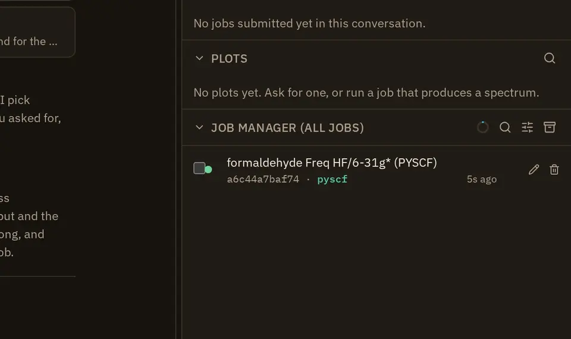
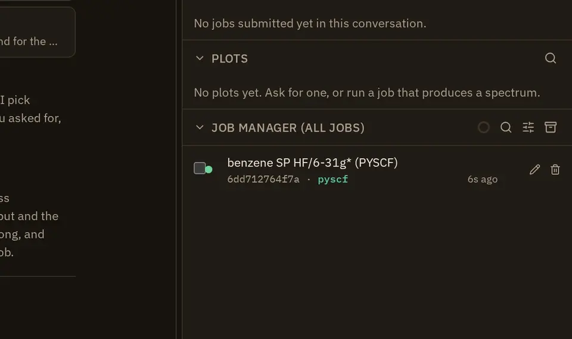
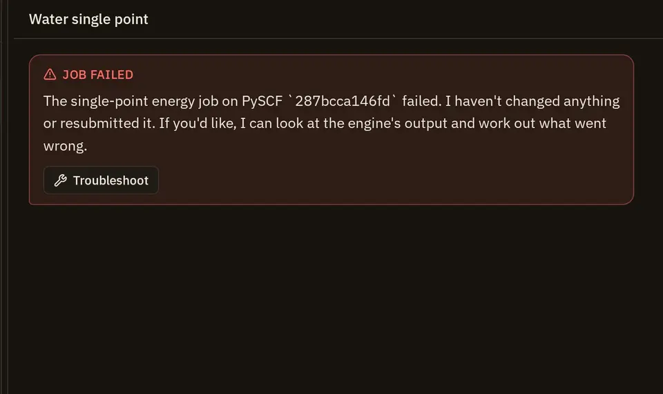
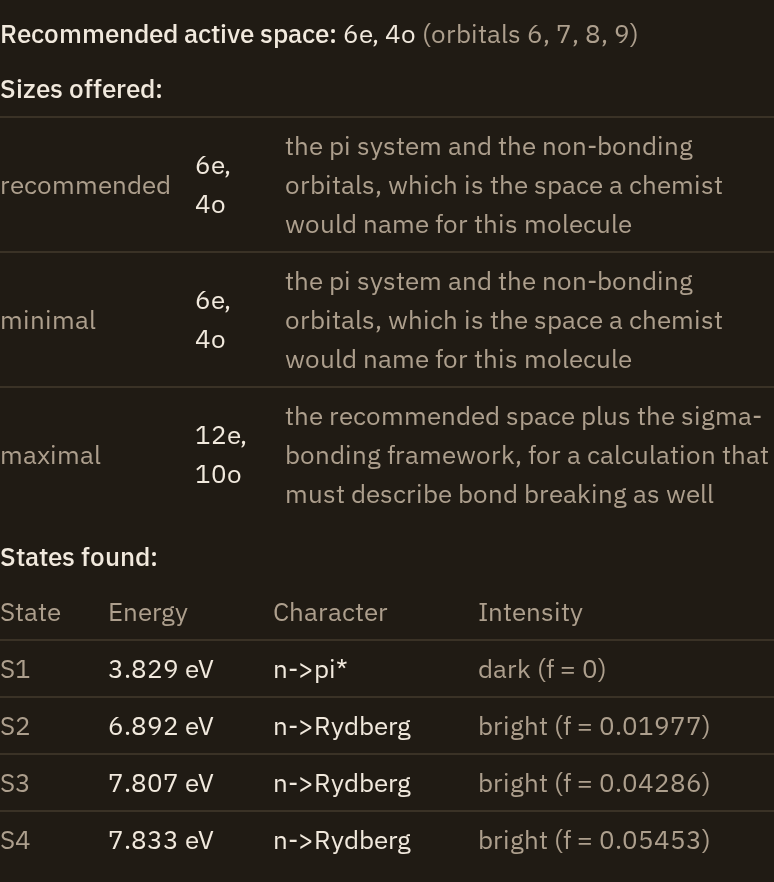
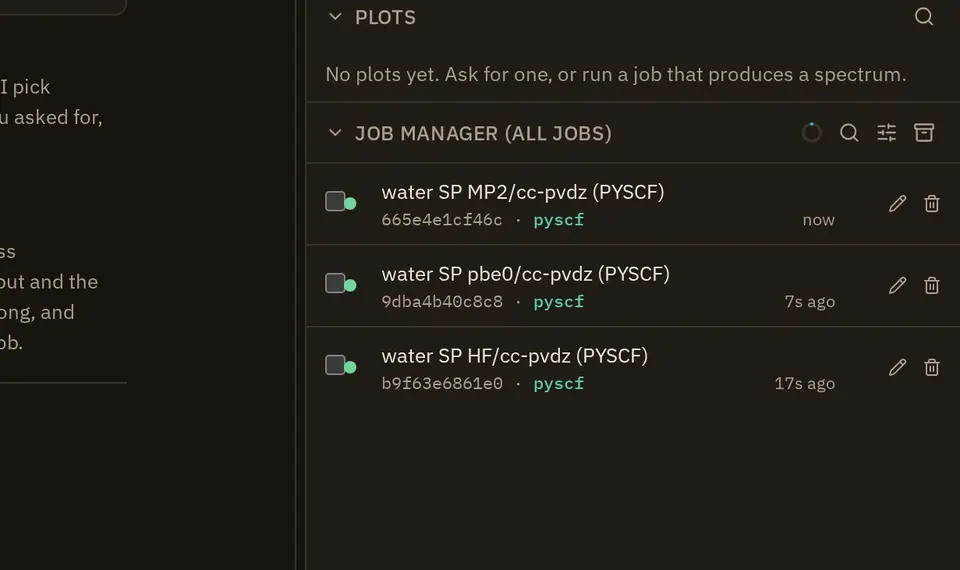
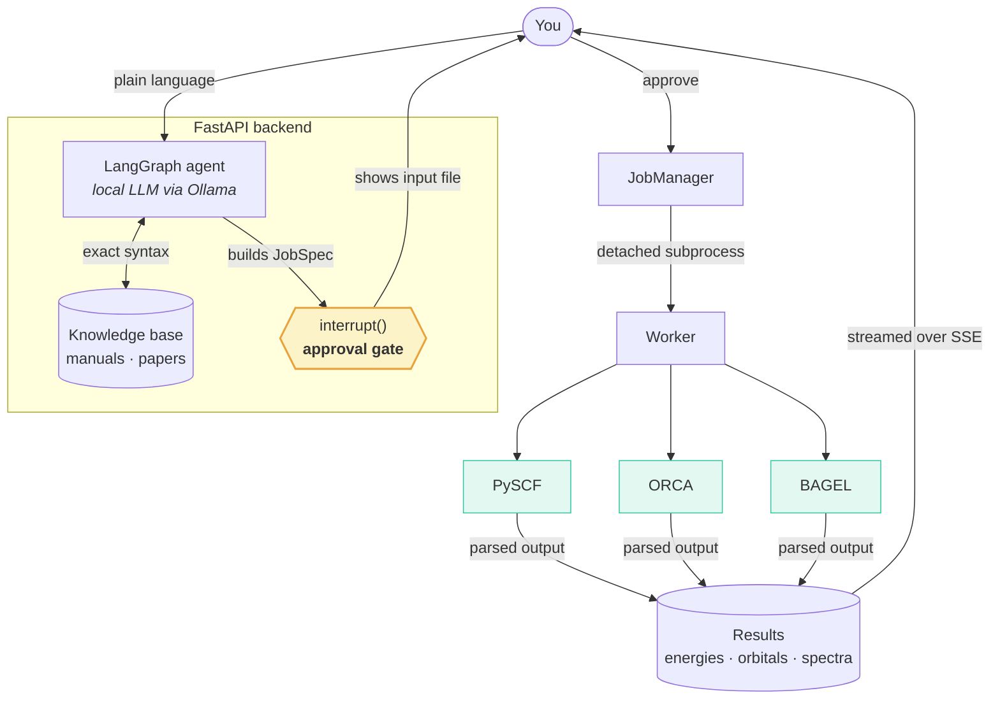

<div align="center">


# NexusQC

### Agentic Quantum Chemistry Engine

**Describe a calculation in plain English. Get real numbers from a real quantum chemistry program.**

[](LICENSE)
[](https://www.python.org)
[](https://nodejs.org)
[](#what-it-can-run)
[](#install)

**[Install](#install)** · **[Tour](#a-quick-tour)** · **[What it can run](#what-it-can-run)** · **[Guide](docs/GUIDE.md)** · **[Report a bug](#found-a-bug)**

<picture>
  <source media="(prefers-color-scheme: light)" srcset="docs/tour/hero-light.webp">
  
</picture>

<sub>One sentence in. The exact input it will run, for you to approve. A spectrum out, parsed from the engine's own output.</sub>

</div>

<table>
<tr>
<td align="center" width="33%"><br><b>Runs on your hardware</b><br><sub>A local model through Ollama. PySCF, ORCA and BAGEL.</sub></td>
<td align="center" width="33%"><br><b>Nothing runs unapproved</b><br><sub>Every job stops and shows you its input first.</sub></td>
<td align="center" width="33%"><br><b>Numbers from the engine</b><br><sub>Parsed from the program's output, never made up.</sub></td>
</tr>
</table>

## Install

One command, on a Linux host with Docker:

```bash
curl -fsSL https://raw.githubusercontent.com/dakshitha-a/NexusQC/main/scripts/install.sh | sh
```

1. **Answer a few questions.** Where to publish it, where ORCA and BAGEL live
   if you have them, and who the first admin is. It generates the secrets and
   the certificate itself.
2. **Wait for the build.** Ten to twenty minutes, once.
3. **Open the link it prints** and type `water`.

You need `docker` with Compose v2, `git`, `openssl` and `curl`. The installer
checks all of them before it asks you anything. For chat you also want
[Ollama](https://ollama.com) serving a tool-calling model; the default,
`qwen3.8:27b`, wants about 24 GB of VRAM.

<details>
<summary><b>Flags, unattended installs, and what each step does</b></summary>
<br>

The installer takes flags through the pipe as well (`... | sh -s -- --bind=lan`),
can run with no questions at all for scripted installs, and prints ten
numbered steps as it goes. All of it is in
[the deployment guide](docs/DEPLOYMENT.md#quick-install-recommended), with how
much GPU you need and what happens with a smaller model.

</details>

<details>
<summary><b>Updating, and running it for a group</b></summary>
<br>

`scripts/update.sh` is the only way a deployment moves forward. It reports
what an update would break, takes a full backup, warns users in the app and
waits for running calculations before it restarts. Admins can run the same
update from the console. Accounts, invites, quotas, sharing and password
resets are covered in [the deployment guide](docs/DEPLOYMENT.md#running-it-for-a-group).

</details>

## A quick tour

<table>
<tr>
<td width="50%"></td>
<td width="50%">

### It asks instead of guessing

Leave out a basis set or an active space and you get a specific question
back, not a default that quietly changes the physics.

[More on asking →](docs/GUIDE.md#what-sets-it-apart)

</td>
</tr>
<tr>
<td>

### Any molecule, one word away

By name, SMILES, pasted XYZ or a sketch, resolved through PubChem and OPSIN
and shown in 3D with numbered atoms. One switch hides the numbers for a
clean picture.

[More on molecules →](docs/GUIDE.md#getting-a-molecule-in)

</td>
<td></td>
</tr>
<tr>
<td></td>
<td>

### Orbitals on every finished job

Every orbital with its energy, occupancy and character. Click one to see it
in 3D, and move the isovalue to taste.

[More on results →](docs/GUIDE.md#what-comes-back)

</td>
</tr>
<tr>
<td>

### Spectra you can tune while you look

A nuclear-ensemble UV/Vis spectrum re-broadens as you drag, with no trip to
the server, and zooms to one band. Every view is normalised to a peak of one.

[More on spectra →](docs/GUIDE.md#what-comes-back)

</td>
<td></td>
</tr>
<tr>
<td></td>
<td>

### Vibrations that move

Normal modes animate on all three engines. Any viewer downloads as it looks
on screen, a mode as an animated PNG.

[More on results →](docs/GUIDE.md#what-comes-back)

</td>
</tr>
<tr>
<td>

### Charts by asking, restyled by asking

Attach a job and ask for the chart you want. Ask again to change the colours,
the text or the axes, and the same plot is redrawn. Every chart is kept, and
downloads as PNG, SVG or PDF.

[More on plots →](docs/GUIDE.md#what-comes-back)

</td>
<td></td>
</tr>
<tr>
<td></td>
<td>

### A failure, diagnosed when you ask

A failed job says so and changes nothing. Press *Troubleshoot* and the agent
reads the engine's own output and the manual, explains what went wrong, and
any fix it proposes comes back as an approval card.

[More on troubleshooting →](docs/GUIDE.md#what-sets-it-apart)

</td>
</tr>
<tr>
<td>

### An active space you can check

Ask for one and it reads the π systems, lone pairs and bonds off the
structure, ranks orbitals by their entropy, and reports three sizes with the
cost of each. It searches the literature for your molecule as well.

[How it chooses →](docs/GUIDE.md#choosing-a-casscf-active-space)

</td>
<td></td>
</tr>
<tr>
<td></td>
<td>

### Finished work, filed away

Tick the jobs you are done with and file them into a project. It downloads as
one zip, with a spreadsheet of every job at the top.

[More on projects →](docs/GUIDE.md#what-comes-back)

</td>
</tr>
</table>

<details>
<summary><b>And a lot more</b>: building on earlier jobs, batches, sharing, downloads…</summary>
<br>

- **Build on what you've run.** Reuse an earlier job's orbitals or geometry,
  and run one calculation over every structure a scan, a path or an ensemble
  produced.
- **Run your own input.** Paste an ORCA or BAGEL input and run it verbatim.
- **Leave and come back.** Calculations run detached. Close the tab; a
  CASSCF job that takes hours is still there when you return.
- **Share with a colleague.** Send a copy of a job or a whole project. Nothing
  arrives until they accept it.
- **Files with real names.** Every download is named after the job and what
  it is, never a column of hex ids.
- **Find in any text.** Inputs, outputs and manuals open in one viewer with a
  typo-tolerant find bar.
- **Your own data, all of it.** Download everything your account holds as
  one zip, or clear it out yourself.
- **A knowledge base of manuals and papers** that the agent searches for exact
  syntax before it writes an input.

[The full guide →](docs/GUIDE.md)

</details>

## What it can run

Ask in your own words. This is what they resolve to. If you don't name a
program, the leftmost one that supports the request runs.

| What you ask for | PySCF | ORCA | BAGEL |
|---|---|---|---|
| **Energies and properties** | | | |
| Ground-state energy | every method | every method | every method |
| Excited-state energies | HF, DFT, EOM-CCSD, CASSCF, NEVPT2, MC-PDFT, L-PDFT, CMS-PDFT | HF, DFT, EOM-CCSD, CASSCF | CASSCF, CASPT2 |
| Energy gradient | HF, DFT, MP2, CCSD, CASSCF, MC-PDFT, L-PDFT, CMS-PDFT | HF, DFT, MP2, CASSCF | every method |
| Non-adiabatic coupling | CASSCF, MC-PDFT, L-PDFT, CMS-PDFT | HF, DFT | CASSCF, CASPT2 |
| **Structure** | | | |
| Geometry optimization | HF, DFT, MP2, CCSD, CASSCF, MC-PDFT, L-PDFT, CMS-PDFT | HF, DFT, MP2, CASSCF | every method |
| Constrained optimization | HF, DFT, MP2, CCSD, CASSCF, MC-PDFT, L-PDFT, CMS-PDFT | HF, DFT, MP2, CASSCF | - |
| Conical intersection | - | HF, DFT | CASSCF, CASPT2 |
| Transition state, by NEB | - | HF, DFT, MP2, CASSCF | - |
| **Vibrations** | | | |
| Frequencies | HF, DFT, CASSCF, MC-PDFT, L-PDFT, CMS-PDFT | HF, DFT, MP2, CASSCF | every method |
| Optimize, then frequencies | HF, DFT, CASSCF, MC-PDFT, L-PDFT, CMS-PDFT | HF, DFT, MP2, CASSCF | every method |
| **Scans, paths and ensembles** | | | |
| Scan a bond, angle or dihedral | every method | every method | - |
| Interpolate between two geometries | every method | every method | every method |
| Excited states at every point of a scan or path | HF, DFT, EOM-CCSD, CASSCF, NEVPT2, MC-PDFT, L-PDFT, CMS-PDFT | HF, DFT, EOM-CCSD, CASSCF | CASSCF, CASPT2 |
| Nuclear-ensemble UV/Vis spectrum | HF, DFT, CMS-PDFT | HF, DFT, EOM-CCSD, CASSCF | CASSCF, CASPT2 |
| Run the same job over a set of structures | every method | every method | every method |
| **Active space** | | | |
| Recommend one | CASSCF | - | - |
| Name the orbitals in it yourself | CASSCF, NEVPT2, MC-PDFT, L-PDFT, CMS-PDFT | - | CASSCF, CASPT2 |
| **Escape hatch** | | | |
| Run your own input file, verbatim | - | every method | every method |

*Every method* means every one that program offers here. The evidence behind
each cell is in [QM_CAPABILITIES.md](docs/QM_CAPABILITIES.md), and what the
table can't show, such as which excited states have gradients, is in
[the guide](docs/GUIDE.md#what-you-can-ask-for). The active-space
recommendation is validated for organic molecules; its benchmark is in
[CAS_ENGINE_METHOD.md](docs/CAS_ENGINE_METHOD.md).

## How it works



- **The approval gate is a real graph interrupt,** so it holds even when the
  model never thinks to ask.
- **Jobs are detached subprocesses.** A calculation outlives the request, the
  session and a backend restart.
- **Engine output is parsed, never generated.** Every parser was written
  against real runs.

[ARCHITECTURE.md](docs/ARCHITECTURE.md) explains each design decision and the
alternatives that were tried and rejected.

## What leaves this machine

The model, the engines and the knowledge base stay local. Four services on the
public internet are contacted, and only for these:

| What | Where it goes | When |
|---|---|---|
| A compound name | PubChem, and OPSIN for systematic names | When you name a molecule |
| A search query | DuckDuckGo | When the agent searches the web |
| A search query | Semantic Scholar | When it searches the literature |

No structure, geometry or result is ever sent. [Limitations](docs/GUIDE.md#limitations)
lists what else is worth knowing before you rely on it.

## Learn more

| Read | For |
|---|---|
| [The guide](docs/GUIDE.md) | Every feature, explained properly, and the limitations |
| [Deployment](docs/DEPLOYMENT.md) | Installing, updating, and running it for a group |
| [Configuration](docs/CONFIGURATION.md) | Every environment variable and job default |
| [Capabilities](docs/QM_CAPABILITIES.md) | The per-method matrix, with the evidence behind each cell |
| [Architecture](docs/ARCHITECTURE.md) | How it works and why, including rejected alternatives |
| [Testing](docs/TESTING.md) | What was tested, and what was not |
| [Development](docs/DEVELOPMENT.md) | Running from source, the two-remote workflow, the safety scan |
| [Backlog](docs/BACKLOG.md) | Known bugs and unfinished work |
| [Changelog](CHANGELOG.md) | What changed in each release |
| [Contributing](CONTRIBUTING.md) and [Security](SECURITY.md) | Reporting bugs, requesting features, and reporting a vulnerability |
| [Notice](NOTICE.md) | Third-party licences |

## Found a bug?

Use the [bug report form](https://github.com/dakshitha-a/NexusQC/issues/new?template=bug_report.yml)
or the [feature request form](https://github.com/dakshitha-a/NexusQC/issues/new?template=feature_request.yml).
In the app, **Help → About** copies the version, and **Report a bug** reaches
your deployment's administrator, with an **Open on GitHub** link for the
public form. [CONTRIBUTING.md](CONTRIBUTING.md) says what happens next.

## Citation

If NexusQC contributes to published work, please cite it, and **also cite the
quantum chemistry program that performed the calculation**. NexusQC orchestrates
PySCF, ORCA and BAGEL; it does not implement the underlying methods.

Metadata is in [`CITATION.cff`](CITATION.cff), which GitHub turns into a
ready-made citation under *Cite this repository*.

## Authors

- **Dakshitha Abeygunewardane**, author, [dma@temple.edu](mailto:dma@temple.edu)
- **Spiridoula Matsika**. Principal investigator, [smatsika@temple.edu](mailto:smatsika@temple.edu)

Matsika Group, Temple University, which was the affiliation when this project
was created. Written with [Claude Code](https://claude.com/claude-code) on Opus.

## License

[MIT](LICENSE). NexusQC bundles or depends on third-party components under their
own licences, including Ketcher (Apache-2.0), 3Dmol.js (BSD-3-Clause), IBM Plex
(OFL-1.1), ASE (LGPL-2.1+) and psycopg (LGPL-3.0). **ORCA and BAGEL are never
redistributed**. ORCA's licence forbids it, and both are bind-mounted from your
own installation. See [NOTICE.md](NOTICE.md).

## Acknowledgements

Built on [PySCF](https://pyscf.org), [ORCA](https://www.faccts.de/orca/),
[BAGEL](https://nubakery.org), [RDKit](https://www.rdkit.org),
[LangGraph](https://langchain-ai.github.io/langgraph/),
[3Dmol.js](https://3dmol.csb.pitt.edu),
[Ketcher](https://lifescience.opensource.epam.com/ketcher/) and
[Ollama](https://ollama.com). Molecule data from
[PubChem](https://pubchem.ncbi.nlm.nih.gov); literature search via
[Semantic Scholar](https://www.semanticscholar.org).
