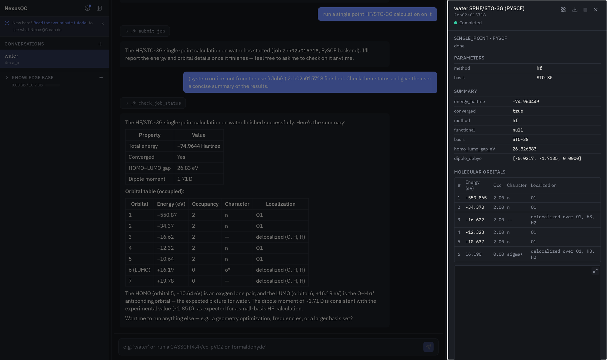

# Using NexusQC

The [README](../README.md) shows what NexusQC does in a few short clips. This
guide explains each feature properly: what you can ask for, what comes back,
and where the edges are.

- [What sets it apart](#what-sets-it-apart)
- [What you can ask for](#what-you-can-ask-for)
- [Building on work you've already done](#building-on-work-youve-already-done)
- [What comes back](#what-comes-back)
- [Getting a molecule in](#getting-a-molecule-in)
- [Choosing a CASSCF active space](#choosing-a-casscf-active-space)
- [Long calculations](#long-calculations)
- [Sharing work with colleagues](#sharing-work-with-colleagues)
- [Things to try first](#things-to-try-first)
- [Limitations](#limitations)

## What sets it apart

Three things separate this from a chatbot with a calculator bolted on.

**Nothing runs without your approval.** Every job pauses on a real graph
interrupt and shows you the exact input file first. That's structural, not a
line in a prompt, so it holds even when the model never thinks to ask. The card
comes up as soon as the setup is complete, and whichever button you press is
answered straight away rather than after another round trip to the model. Ask
to see an input without running it and it stops short of the card.

**It asks instead of guessing.** Missing a basis set or an active space? You
get a specific question back rather than a silently chosen default that
quietly produces the wrong physics.

**Failures get diagnosed, but only when you ask.** A failed job says so and
changes nothing on its own. Press *Troubleshoot* and the agent reads the
engine's actual output, checks the manual, searches the web if it has to, and
explains what went wrong. Any corrected job it proposes still goes through the
approval gate, because guessing at a fix can burn hours of compute you never
agreed to.

## What you can ask for

Ask in whatever words you'd use with a colleague. The
[capability table in the README](../README.md#what-it-can-run) says which
program runs which method for which task. It is read directly from the app's
capability registry, and its columns are in routing order: if you don't name
a program, the leftmost one that supports your request is what runs. What
follows is what the table can't show.

The active-space recommendation is validated for organic molecules. It answers
for a molecule containing a transition metal and says, on the job itself, that it
is outside what has been measured: a metal contributes its valence d shell and
nothing else, and the answer is basis dependent in a way the organic benchmark
is not. [`docs/CAS_ENGINE_METHOD.md`](CAS_ENGINE_METHOD.md) is the method of
record and carries the benchmark it rests on.

*Every method* means every one that program offers here: for PySCF, HF, DFT,
MP2, CCSD, EOM-CCSD, CASSCF, NEVPT2, MC-PDFT, L-PDFT and CMS-PDFT; for ORCA,
the same list without the last four; for BAGEL, HF, CASSCF and CASPT2. The per-method
evidence behind every cell, down to which ones were executed here versus taken
from a manual, is in [QM_CAPABILITIES.md](QM_CAPABILITIES.md).

A few things the table can't show. One gradient job can cover several
electronic states, and one coupling job several pairs of them, so ask for all
the states or pairs you want at once rather than submitting a job each. Where
the program supports it the whole set comes from a single calculation, which
is most of the saving: on BAGEL the couplings between every pair among S0, S1
and S2 cost barely more than one of them. Where it does not, the job runs the
program once per state or pair on your behalf and still hands back one
result. On a single-reference method (HF or DFT) the couplings available are
ground-to-excited only, which is a property of the program rather than a
choice made here.

Which states you can take a gradient on is narrower than which methods have a
gradient at all, and the table above shows the second. For a multireference
method, only BAGEL computes a gradient on an excited surface here: PySCF's
CASSCF gradient is ground-state only, and while ORCA documents one for a
CASSCF root, this app does not yet ask for a root in the input it builds, so
it would return the same answer whichever state you named. Ask for excited
states and the job goes to BAGEL on its own; ask for them on an engine that
cannot, and you get told so before anything runs rather than a plausible
ground-state number afterwards. Excited-state gradients on HF or DFT are
unaffected and work on PySCF and ORCA alike.

"Run the same job over a set of structures" takes the geometries from any job
that produced several -- a scan, an interpolated path, a nuclear ensemble, an
NEB run, or a set you uploaded -- and runs one calculation per geometry. That
calculation can be an energy, excited states, a gradient, the couplings
between state pairs, an optimization (plain, constrained, or onto a conical
intersection), frequencies, or an optimization followed by frequencies. Any of
them that solves for electronic states reports where those states were, in
absolute energies, at every geometry -- so a run of couplings along a scan
answers how strongly the states couple and where they lie, without a second
run over the same structures. For a
constrained optimization across a set, naming a coordinate without a value
holds it at whatever value each structure already has, which is the usual way
to relax everything except the coordinate a scan was driving. When the results
share a scan coordinate, the finished set is plotted against it.

TDDFT, TDA-DFT, CIS and TD-HF are all the
excited-state row at HF or DFT with one flag toggled, not separate calculations
to choose between. Two requests override routing order regardless of what you
asked for. CASPT2 always goes to BAGEL, since it is the only one of the three
that has it here. A CASSCF job that needs oscillator strengths also goes to
BAGEL, which is the preferred engine for those on this deployment; ORCA
computes them too and is used if you name it, and PySCF cannot report an
intensity for a CASSCF state at all.

NEVPT2, MC-PDFT, L-PDFT and CMS-PDFT are PySCF only, and they all build on a
CASSCF wave function, so each needs an active space stated the way CASSCF does.
The three pair-density ones also need an on-top functional, which is a
different thing from a Kohn-Sham one: tPBE and ftPBE rather than B3LYP or PBE0.

Two things about them are worth knowing before you ask. NEVPT2 gives energies
and nothing else, because PySCF has no NEVPT2 gradient: there is no optimizing
or frequency-taking at that level, only energies at a geometry you already
have. And of the four, **only CMS-PDFT gives you transition intensities**, so
it is the one to pick if you want a UV/Vis spectrum from a multireference
calculation rather than only a list of excitation energies. L-PDFT is the
better multi-state method in every other respect and is the one to prefer when
you do not need intensities.

Excited states from **every** multireference method here mean states of the
same multiplicity as the ground state, the same convention TDDFT already
follows: a closed-shell molecule gets singlets. That is worth stating because
it was not always true. Until 2026-08-29 a state-averaged CASSCF on PySCF
returned the lowest states of any multiplicity, so what was labelled S1 could
be a triplet. ORCA and BAGEL never had the problem, and a single-state
calculation was never affected.

Orbital visualisation isn't in the table because it isn't a calculation. Every completed job already has
its orbitals in its own drawer.

Ask for something none of the three can do, a Gaussian or Psi4 calculation say,
and you'll get the input file written out in chat along with a plain statement
that it can't be run here.

## Building on work you've already done

Any job built on a CASSCF wave function, which is CASSCF, CASPT2, NEVPT2,
MC-PDFT, L-PDFT and CMS-PDFT, can start from a previous one's converged orbitals
instead of a fresh guess. Tag the source job and the new one restarts from it.
Same engine only, since orbital files don't convert between programs. On PySCF
this can cut macro-iterations noticeably when the two geometries are close; ORCA
and BAGEL use their own restart mechanisms, `MOREAD` and `load_ref`.

A new job can also run on a **previous job's geometry** rather than whatever is
in the molecule panel. "Run that again with a bigger basis" works, and so does
"same geometry as job X". The agent already has the job id from the
conversation, so it never asks you for one. It takes the optimized geometry if
the job produced one, otherwise the input geometry. A job with no single
geometry of its own, like a scan or a Wigner ensemble, is refused by name rather
than guessed at.

A **nuclear-ensemble spectrum** always builds on earlier work, because there is
nothing to sample without a molecule's vibrations: it draws its geometries from
a finished frequency calculation's normal modes. Tag that job and ask for the
spectrum. If you haven't run one, say so and the agent will set the frequency
calculation up first, then sample the ensemble from it once it lands.

For the CASSCF-based methods, every sample also starts from that same frequency job's
converged orbitals rather than from its own fresh guess. Besides saving the
work, it is what keeps the active space the same one from sample to sample, so
the pooled spectrum is a single space sampled many times instead of a mixture
of whatever each geometry happened to converge to. You will see it filled in on
the approval card and can point it at a different job or take it out. If the
frequency job cannot supply orbitals, because it ran at DFT or on another
program, the ensemble says so and falls back to a fresh guess per sample.

## What comes back

**Orbitals on every completed job**, with per-orbital energies and occupancies.
Click a row for a 3D isosurface with an isovalue slider. CASSCF shows genuine
fractional natural-orbital occupations rather than integer HF-style ones.
Enlarging the panel keeps the list beside the isosurface, so you can work down
the orbitals, or the vibrational modes, without shrinking the view again each
time.

**UV/Vis and IR spectra**, with the leading orbital-pair character named for
each excited state, read from the engine's own CI vectors rather than inferred.
Vibrational modes animate on all three engines. Nuclear-ensemble spectra pool
across every sampled geometry, with a per-state breakdown under the total curve.
Both the live preview and the finished figure plot energy in eV, the convention
these spectra are read in. The preview carries two controls: a broadening-width
slider, which re-renders as you drag it because the transitions are fetched once
and re-broadened in the browser with no server round trip, and a two-handled
energy window for zooming in on one band. The finished figure trims its own
x-axis to where the curve is still worth looking at, so a couple of eV of
Gaussian tail doesn't crowd out the band; the spectrum file that downloads
alongside it is untrimmed, since that one is the data rather than the view.

When a job genuinely has no oscillator strengths or IR intensities to plot, it
says so instead of drawing a flat line and pretending otherwise.

Two methods' spectra go on one axis by asking for it. Say you want the UV/Vis
spectra of the TDDFT and the EOM-CCSD run compared, and both curves are drawn
together, each normalised to its own peak so the shapes and band positions line
up rather than the taller one flattening the other. It works the same for a
nuclear-ensemble spectrum against a single-geometry one, and for several IR
spectra. Asking for wavelength instead of energy redraws the same comparison in
nanometres. Two spectra can also be subtracted rather than overlaid, which is
what you want once two methods agree closely enough that the curves sit on top
of each other. An IR spectrum and a UV/Vis spectrum are not put on one axis,
since wavenumbers and electronvolts are not the same scale, and the reply says
that rather than drawing something meaningless.

Four more charts come from numbers your calculations already produced. The
**molecular orbital levels** either side of the gap, with the HOMO and LUMO
picked out and the gap measured. **How a geometry optimization approached its
minimum**, drawn relative to the energy it finished at so the last few steps
are legible rather than a flat line. **Each excited state** at its own energy,
as tall as its oscillator strength and labelled with the orbitals that move,
which is the question a broadened band raises and cannot answer. And **how a
Wigner ensemble's samples are spread**, the standard check before you trust the
spectrum pooled from them. And a **thermochemistry breakdown** from a frequency
job, showing what the zero-point, thermal and entropy corrections each
contribute between a bare electronic energy and a free energy.

An orbital diagram is refused for a CASSCF calculation rather than drawn. Those
export natural orbitals, which carry occupancies but no orbital energies, so a
diagram would be a stack of levels at zero and a HOMO-LUMO gap measured from a
number nobody calculated.

Attaching a spectrum job to a prompt now hands over the curve itself, not just
the peak positions and heights behind it, so the agent can quote where a band
sits and how tall it is without redrawing anything.

Beyond the standard spectra, you can describe the chart you want and get it.
Ask for the excitation energies of seven methods with the method names along
the bottom and a stack of horizontal lines for each state, colour coded with a
legend, and that is what you get. The x axis is either a real number you name
or one column per calculation, the marks are lines, points, bars or energy
levels, and each series carries its own colour and legend entry. If one of the
methods never produced the quantity you asked for, its column stays on the
chart with that slot left empty, and the reply says which ones those were.

Plots are kept, not thrown away after one message. The **Plots** section of the
instrument panel lists every chart the app has drawn, yours and the spectra
jobs produce on their own, each with a thumbnail, a name you can change, and
buttons to attach, download or delete it. One filter box narrows the list, and
clicking a row opens the chart full size alongside the numbers behind it. Attaching one to a prompt lets you
ask about it, and asking for a change ("make the y axis log", "drop the CASSCF
column", "colour S2 red") edits the plot rather than starting a new one. Each
edit keeps the previous image, so an older message still shows the chart it was
actually talking about.

Any chart restyles by asking. Title, axis labels, font sizes, figure size,
grid, axis ranges, colours, line and marker settings, and where the legend
goes, including beside the chart rather than on top of it. Asking for bigger
text scales the title, the axis labels, the tick numbers and the legend
together, so one request does what you meant. A chart can be downloaded as SVG
or PDF as well as PNG, at whatever size and font you set, which is what a
figure headed for a paper needs.

Any chart can carry text. Ask for the values on a method comparison and each
number is written beside its own bar or energy level. The numbers are the
ones the plot drew, so a label cannot disagree with the mark it sits next to.
On an energy-level diagram they sit at the right end of each level, so two
states a fraction of an eV apart stay readable. You can also put a note at
one point on any chart, a spectrum included, with or without an arrow
pointing at it: "mark the S1/S2 near-degeneracy for CASPT2", say. A note can
be moved, reworded or removed later like any other change to the plot.

A plot is kept for as long as any of the calculations behind it is still
around. Delete one of the seven jobs behind a seven-method comparison and the
chart stays; delete all seven and it goes with them, since by then there is
nothing left to redraw it from.

**Everything on screen downloads**, not just the job data. That includes a PNG
of a 3D viewer in its *current* state, the angle you rotated to, the isovalue
you picked, the frame you're on, and a vibrational mode as an animated PNG.
Every file a job hands you is named the same way: the job, then which of its
files this is, then a real extension. A downloads folder reads as
`20260817_water_Freq_HF_sto-3g_ORCA_78a32a61_mode3_3840cm-1.png` rather than a
column of hex ids, and renaming a job carries through to its downloads.
Punctuation a filesystem would object to is stripped from the job's name on the
way through, so a job called `H2O CASSCF(6,6)/cc-pVDZ` still lands as a file you
can open.

**Every text viewer has a find bar with typo tolerance.** Raw input and output,
knowledge-base manuals, uploaded geometries, all open into the same viewer.
Ctrl/Cmd+F focuses its search box without leaving the page, matches are counted
and highlighted, and a query that's close but not exact still finds the word.

**Finished work can be filed into a project.** The job list otherwise only
grows, and a study that took thirty calculations sits on top of the next one's
forever. Tick the jobs you're done with, choose "Add to project", and give the
project a name. Those jobs leave the job list and the project appears in the
left sidebar, next to your conversations and files, showing how many jobs it
holds and how much disk they take.

A project can be renamed, opened to see what's in it, and downloaded as a
single zip. The zip has a spreadsheet at the top listing every job in it by
name, method, program, status, date and result, which is what makes an archive
you come back to in a year worth having; underneath it, each job's own files
keep the names its program gave them, so an unpacked ORCA job still has an
`input.inp` you can rerun.

Nothing is hidden permanently. "Show archived" in the job manager brings
archived jobs back into view, each labelled with the project it belongs to, and
one click sends any of them back. You can also send several back at once from
inside the project. A job lives in one project at a time, so filing it into
another moves it rather than copying it.

Deleting a project asks which you mean, every time, and never assumes: you can
delete just the grouping, in which case the jobs return to the job list
untouched, or delete the results along with it, which asks you to type the
project's name first. Archived jobs still count towards your storage quota, but
they are the last thing it reaches for: everything you haven't filed away goes
first.

 
A finished eight-image path scan on methylamine. Every number in the drawer is parsed from PySCF's own output.

## Getting a molecule in

By name, SMILES, pasted XYZ, or a sketch. Resolved through PubChem and OPSIN,
then shown in 3D with numbered atoms. You don't have to run a calculation just
to look at something.

The numbering is what lets you say "the C4-C6 bond" and be understood, but it
is in the way when you want a clean picture. One switch in the molecule pane
turns it off everywhere at once, structures, orbitals and vibrations alike, and
the images and animations you download follow whatever is on screen. The same
switch sits in the corner of each viewer, so you can reach it without leaving
what you are looking at.

Or upload it. Drop an `.xyz` on the composer and one geometry becomes the active
molecule, two become a start/end pair for an interpolated path or NEB, and three
or more become a taggable set you can pull individual frames from later. Pasting
the same geometries straight into the message does the same thing, by the same
rules, so a scan you generated somewhere else can go in as text. Atom-count
lines are optional; a title above each block is kept, and if those titles carry
one number each ("Torsion angle at 0", "at 10", and so on) that number becomes
the x axis of anything you run over the set. ORCA and BAGEL input files upload
the same way; the content lands in the chat itself, so "run this verbatim" fills
a blind job's input from what you attached with nothing to retype.

Whatever you paste is read before it runs, so the app can tell you what it is
and offer to build the equivalent job properly instead. It reads the level of
theory the input actually computes rather than the block it starts from, which
matters on BAGEL, where every CASSCF input opens with a Hartree-Fock section
because those orbitals are the starting guess. It also counts the states: on
CASSCF and CASPT2 nothing else in the file says whether you asked for one
energy or a set of excitation energies.

A verbatim run keeps every file it wrote. If your input asks the engine for an
orbital file, you get it, both in the job's download and in the orbital viewer,
even though nothing else about the calculation is parsed.

Basis sets and functionals are matched against the names each engine really
recognises, so a typo gets you a short menu instead of a guess. If nothing in
the menu is right, its last entry searches
[Basis Set Exchange](https://www.basissetexchange.org/) for the published set,
bundled offline, not a network call, and confirms it covers every element in
your molecule before offering it.

**Say a functional the way you say it out loud.** "ωB97X-D", "m062x", "r2scan".
Each engine spells these differently and sometimes not at all, and you should
not have to remember which. Ask for M06-2X and ORCA gets `M062X`, because ORCA
rejects the hyphen. Ask for SCAN and ORCA gets `SCANFUNC`, because plain `SCAN`
is its geometry-scan keyword. Ask for ωB97X-D on PySCF, which cannot run it at
all, and you get its supported near-equivalent with a note saying why. Every
rewrite is shown on the approval card before anything runs, and where the
request is genuinely ambiguous, a bare "-d3", where the two damping schemes
give different energies. You are asked rather than chosen for.

The names on offer are ones the engine will really run. That sounds obvious and
was not: half a functional is a valid name to a quantum chemistry library, and
asking for r2SCAN used to be able to get you its exchange half, which converges
happily and quietly gives the wrong energy.

## Choosing a CASSCF active space

Picking an active space by hand is one of the more error-prone judgement calls
in multireference chemistry. Too small and you miss the physics; too large and
it's intractable.

Ask for one and you are asked a single question first: how many electronic
states you want. The default is the ground state alone, and the answer changes
what gets recommended, so it is not guessed. You are **not** asked for a basis
set. The recommendation does not depend on one, and asking for something whose
answer changes nothing is just a round trip.

NexusQC also searches the literature for **your** molecule -- your uploaded
papers, then published work, then the open web -- and if nothing has been
published for it, you are told that plainly. An active space reported for a
similar-looking compound is not a weaker answer to your question; it is an
answer to a different one.

**How the recommendation is made.** The directions that matter are read off the
structure itself: the π normal at each planar centre, the lone-pair directions
on each heteroatom, the axis of every bond. Orbitals are then selected by how
much of that character they carry, ranked by an approximate pair-coefficient
entropy, and reported at three sizes with the cost of each.

Geometry decides how many lone pairs a heteroatom really has, which is why a
planar nitrogen with three neighbours, the kind in pyrrole or an amide, is not
given one. Its non-bonding electrons are the π orbital that the planar centre
already contributes, and counting them twice used to put an orbital in the
space that does not exist.

Two consequences are worth stating because they are unusual.

*The answer does not depend on the basis set, or on how your geometry happens to
be oriented.* Benzene gives (6e, 6o) and butadiene (4e, 4o) whether the
calculation is run in STO-3G or aug-cc-pVDZ, and whether the molecule arrived
from PubChem lying in a coordinate plane or at an arbitrary angle. The one real
exception is Rydberg states, which cannot be described without diffuse
functions; when the analysis basis has none, you are told they were not looked
for rather than handed a valence answer that looks complete.

*There is no size limit.* The previous version refused anything above twelve
orbitals, because it ended by running a full state-averaged CASSCF and had to
fit inside what that could afford. This one does not run that CASSCF. A large
space is reported with its determinant and CSF counts and which engines can
actually reach it, and you decide.

**If you want more than the ground state**, say how many states and the engine
runs a quick linear-response pass to find out what they are actually made of. It
reports each one's energy, whether it is bright or dark, and its character --
n→π\*, π→π\*, or Rydberg -- and then checks that the recommended space really
contains them, telling you if one is missing. Dark states matter here: a dark
n→π\* state needs the heteroatom lone pair, and choosing orbitals by
ground-state correlation alone is how that orbital gets left out and the state
silently disappears.

**Or name the orbitals outright.** If you have looked at a previous job's
orbitals and know which ones you want, say so and those are the ones used,
rather than however many the engine would take around the HOMO. Give as many
orbital numbers as the space is wide and they go in as they are. BAGEL and
PySCF can both do this; ORCA has no way to express it, so asking for it on an
ORCA job offers you the two engines that can instead of quietly ignoring you.

An orbital number is a row of one particular job's orbital table, so the new
job starts from that job's orbitals with exactly those rows active. Attach the
job whose table you read the numbers from, or name it; if you do neither and
the conversation holds more than one job with a table, you are asked which.
Saying "fresh" means the numbers refer to the new run's own SCF orbitals, whose
numbering is not any earlier table's. You can also edit a space rather than
retype it: "repeat that with orbital 26 swapped for 21" is applied to the
previous job's recorded active window and the full list goes on the card.

Every multireference result records which rows of its own table were active,
and, against the orbitals it started from, how much of each survives in the
converged space. CASSCF is free to rotate an orbital out of the active space
if a lower energy lies that way, and when it does the result says so, names
the orbital, and the job's summary leads with it. The energies are then those
of the space it found, not the one you asked for.

This is only ever used when you name the orbitals. NexusQC will not put a list
together out of orbital numbers that happen to be in the conversation already,
because a guessed active space arrives on the approval card looking exactly like
a chosen one while computing something else.

**What you get back**, in about a second: the recommended space and two
alternatives either side of it, every orbital classified by character (σ/π/n/σ\*/
π\*) and dominant atoms, an isosurface viewer, the orbital ranking, and -- unless
you turn it off -- a CASCI in the chosen space confirming the states you asked
for are really in it. The result is reported against the literature search that
preceded it, including when the two disagree.

The method, its relationship to AVAS, autoCAS and AEGISS, and its benchmarks
against the QUEST reference database are written up in
[`docs/CAS_ENGINE_METHOD.md`](CAS_ENGINE_METHOD.md).

**If you want the space checked rather than predicted, ask for the refinement.**
Everything above is decided without running a CASSCF, which is what makes it
cost a second. The refinement is the opposite trade: it takes a finished
recommendation and actually solves in it, so the space is measured rather than
estimated. It is offered after the quick answer and runs only if you accept,
because it takes minutes rather than a second.

What it does, in order, and the order is the point. It solves the state-averaged
CASSCF over the states you asked for. It checks that the states you asked for
are really among the roots, and if one is missing it puts the character back
that went astray and solves again. Only once the states are stable does it drop
orbitals, and only those whose occupation stayed pinned at doubly occupied or
empty across every averaged state. Then it re-solves to confirm nothing moved by
more than a fifth of an electronvolt, and puts back anything that did.

Taking those steps in the other order is a trap worth knowing about, because
occupations alone look like sound evidence. On uracil averaged over four states,
both carbonyl lone pairs relax to occupations of about 2.00 and an occupation
cut removes both, which also removes the n→π\* state that needs them, while
appearing to have proved they were never used.

**What the refinement gives you** is a smaller space with the reasoning attached:
every orbital's occupation, what each orbital actually is, and an ordered list of
every change it made with the number that justified it. The changes are written
so you can reproduce them by hand, because a space you cannot rebuild is worth
less than a larger one you can. You also get the converged orbitals in two
files: the set to restart a production CASSCF from, and a second set in the
natural-orbital basis that the reported occupations and characters describe.
Those are different orbitals spanning the same space, so reading the table
against the wrong file gives the wrong answer.

Two honest limits. On a hard case the answer can depend on the path the
optimisation took, so treat a single run on a molecule like uracil as one
sample rather than a settled result. And with only the ground state requested
the occupations are the sole evidence available, which is where the refinement
is weakest.

**On what the characters mean.** Each orbital is named as π, π\*, n, σ or σ\*,
and the weights behind the name are reported next to it. Some orbitals are
genuinely both: a lone pair on a heteroatom is an sp hybrid, so it overlaps the
σ framework by construction, and no threshold separates the two cleanly. Those
are labelled `n/sigma` rather than forced to one side. When you disagree with a
label, the weights are there to overrule it.

Each orbital also carries how much of its density lies outside the molecule,
which is what a diffuse or Rydberg-like orbital looks like from the outside. An
orbital past the halfway mark is flagged and stops being described by which
atoms carry it, because a population analysis of something centred nowhere
describes nothing. That is a measure of how far the orbital reaches, not a
Rydberg assignment. On PySCF and BAGEL; ORCA tables carry neither this nor the
character column, for the reason in the architecture notes.

Two knobs matter if you work on excited states, and both were added because
the defaults quietly answer a different question than you may be asking.

**A pool with nothing unoccupied in it is a non-answer, and the engine no
longer produces one.** For a molecule with no π system -- water, ammonia,
methane -- selecting on π and lone-pair character alone returns orbitals that
are all doubly occupied: one configuration, no correlation described at all.
The old version met this from the other direction, seeding three oxygen 2p
orbitals holding six electrons, and worked around it by bringing the hydrogens
in and then refusing if that still failed. Every bond now contributes its σ and
σ\* to the candidate pool, so water comes back as (8e, 6o) with virtuals in it
and needs no special case.

Three more things worth knowing before you read a recommendation:

- **The basis is not upstream of the answer.** It used to be: the previous
  version computed its selection in whatever basis you named. This one does
  not, so the basis you eventually run in is a free choice.
- **The state count is the lever that matters.** Ask for excited states and the
  orbitals those specific states need are put in, whether the states are bright
  or dark. Ask for the ground state and you get the correlated valence space.
- **Rydberg states are reported, not absorbed.** They are found when the basis
  can describe them, and deliberately left out of the valence space -- diffuse
  orbitals do not mix with valence ones and are a reliable way to make a CASSCF
  hard to converge for no gain. You are told they are there and that a CASSCF
  in this space will give you the valence states only.

You can also just ask about a space you already have -- "is (8e,8o) sensible for
this?" -- which runs no calculation and answers from the same literature search.

> A minimal basis systematically under-represents diffuse and Rydberg character.
> Treat an STO-3G recommendation as a starting point, particularly for excited
> states with charge-transfer character.

If that matters to you, the orbital table is where to look: run the same
molecule in a basis that carries diffuse functions and the diffuseness column
fills in. On water, cc-pVDZ produces nothing above 0.22 while aug-cc-pVDZ finds
five orbitals between 0.63 and 0.94, the lowest of them just under 1 eV.

## Long calculations

A reply from a local model can take a while to start, especially late in a
long conversation. While it works, the chat shows how many seconds it has been
thinking, so a slow reply looks like a slow reply and not a dead one. If the
model comes back with nothing at all, the app asks it once more. If the second
try is also empty, the chat says so and asks you to send the message again,
instead of leaving you looking at silence.

A CASSCF job can run for hours. Close the tab and come back; it'll still be
there, and nothing about the UI blocks while it runs, and nothing stops it: no
job has a time limit unless an operator sets `QC_AGENT_JOB_TIMEOUT_HOURS`. On a shared machine it
tries to be a good neighbour: every job takes four cores by default, on any of
the three engines and enforced on the engine's own subprocess rather than left
to it, up to twenty run at once, and a new one is admitted only when the host
genuinely has headroom, so an idle machine gets used and a busy one gets left
alone. All of that is tunable. The cores each calculation gets can be changed
from the admin console while the app runs, under **Cores per calculation**;
jobs started after the change use the new number, and running ones keep theirs.
See [CONFIGURATION.md](CONFIGURATION.md#job-execution-and-resource-limits).

## Sharing work with colleagues

**People can pass work to each other.** Find a colleague by name or username,
send them a copy of a finished calculation or a whole project archive, and it
turns up in a "Shared with me" section in their sidebar. Nothing is copied until
they accept, so nobody can fill your storage without your agreement, and you can
withdraw an offer until it is answered.

It is a real copy rather than a window onto yours, and that cuts both ways. It
goes on working after you delete your own, which is the point; it also does not
follow your later renames or re-runs. It occupies storage on both accounts, and
an offer too large for the recipient's allowance is refused with the actual
numbers rather than being made to fit by deleting something of theirs. A scan
travels with all of its images, a spectrum travels with its picture, and a
shared project arrives as their own project holding their own copies. Received
work is labelled with who sent it. Conversations are not shareable.

## Things to try first

Then open the URL the installer printed and type `water`.

| Say this | To see |
|---|---|
| `water` | Structure resolution and the 3D viewer |
| `run a single point HF/STO-3G calculation on water` | A background job, with the approval card in the chat |
| `run a CASSCF calculation on formaldehyde` | It asking for the basis and active space instead of guessing |
| `what active space should I use for butadiene?` | A literature search, then an offer to compute one |

## Limitations

Worth knowing before you rely on it.

**CASPT2 is BAGEL-only**, and EOM-CCSD oscillator strengths are ORCA-only.
Neither has a workaround. CASSCF oscillator strengths are available on both
ORCA and BAGEL, and only PySCF has no route to them.

**ORCA refuses an excited-state gradient or NAC for B3LYP and BLYP**, and there
is no working substitute here. A documented LibXC rewrite was tried and came
back with a ground-state energy about 1.2 Hartree off from real B3LYP, so the
combination is refused outright rather than run with a functional that isn't the
one you asked for. That's a confirmed absence in ORCA itself, not syntax this
app got wrong. The check matches exact functional names, so another B88-derived
functional like CAM-B3LYP or BP86 slips past it and fails with ORCA's own error
at run time instead. Still safe, since no rewrite is ever applied, just less
informative than the pre-submission refusal. PBE0 works, or ask for the
ground-state gradient.

**Bare `wb97x-d` is invalid on both PySCF and ORCA**, for opposite reasons,
despite being the form most papers write. PySCF's libxc parser accepts the name
but its TDDFT gradient driver has nothing behind it; ORCA's functional list has
no entry without an explicit dispersion version and rejects it at input-check
time. Plain `wb97x` is confirmed working end to end on both. `wb97x-d3` works on
ORCA but not PySCF. `wb97x-d3bj`, `wb97x-d4` and the VV10 forms are real ORCA
keywords that crashed or aborted in testing here, so they aren't offered as
verified. See [PARSER_GAPS.md](PARSER_GAPS.md).

**NEB transition-state search is ORCA-only**, and its excited-state path is less
verified than the ground-state one. **BAGEL's CASSCF geometry optimization and
frequencies are structurally confirmed but not convergence-verified** end to end.

**This app is reached over a LAN address and a tailnet address, and nothing
else.** There is no public-internet listener; a second nginx block for one was
removed on 2026-08-25, along with the admin toggle and host firewall script
that had been built to control it, because its port had never been published
and so none of it was guarding anything. Serving publicly means restoring that
listener deliberately, with a real certificate and a fresh decision about how
access gets withdrawn.

**There's no general pre-flight validator** for basis sets and keywords. An
invalid basis gets caught when the engine fails, and *Troubleshoot* is how you
turn that failure into a diagnosis.

**The model, embeddings, engines and knowledge base all stay local. Four
services on the public internet are contacted**, and it is worth knowing
which, because a compound name is exactly what someone choosing a local tool
assumes stays on their machine:

- **Web search** sends your query text to DuckDuckGo.
- **Molecule resolution by name** sends the compound name to PubChem, and
  systematic names to the hosted OPSIN service at `opsin.ch.cam.ac.uk`.
- **Literature search** sends query text to Semantic Scholar.

None of them carries a structure you drew, a geometry you computed, or any
result. A name being looked up is the whole of what leaves.

Fuller list in [ARCHITECTURE.md](ARCHITECTURE.md#known-limitations), with
what has and hasn't been exercised in [TESTING.md](TESTING.md) and
[BACKLOG.md](BACKLOG.md).
